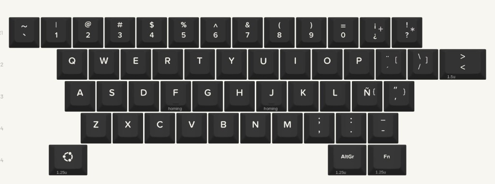

# Spanish (ANSI)

A **Spanish keyboard layout for standard ANSI hardware** (104/105 keys, no ISO key left of Z). It remaps a US-style physical keyboard so Spanish and the other languages of South America are comfortable to type without buying an ISO keyboard from Spain or Latin America.

ANSI is the most widely sold keyboard form factor. Targeting it first opens a larger hardware market. The project starts as a **software layout** and already has a **physical keycap template** (legend kit) so the same map can be printed on Cherry-profile caps for ANSI boards.

System name: **Spanish (ANSI)**. Short indicator: **ESA**. Layout id: `esansi`.

| Platform | Files | Guide |
|---|---|---|
| Linux (XKB) | [`linux/xkb/`](linux/xkb/) | [`linux.md`](linux.md) |
| Windows | [`windows/esansi.klc`](windows/esansi.klc) | [`windows.md`](windows.md) |
| macOS | build with Ukelele | [`macos.md`](macos.md) |
| Physical keycaps | [Yuzu ESA set](https://yuzukeycaps.com/c/6ac3d7c8-8c10-4578-98be-3831ab731efb) | [Physical keycaps](#physical-keycaps-yuzu) |

## Why this layout

Most ANSI layouts that add Spanish support put **accents and `ñ` on AltGr**. That is fine for occasional loanwords; it is uncomfortable for real Spanish writing, where acute accents and `ñ` appear constantly. This layout keeps those on the base and Shift layers, the way a Spain ISO keyboard does, so everyday Spanish stays fast.

It also **optimizes the opening marks**: to the right of `0`, `¿` and Shift+`¡` share one key, and `?` and Shift+`!` share the next. You do not dig through AltGr to open a question or an exclamation.

For **coders**, brackets follow the muscle memory Spanish (Spain) programmers already use: `{` `}` `[` `]` on AltGr next to the home and top rows. You can write Spanish prose and code on the same board without switching layouts or relearning symbol chords.

Beyond Spanish it covers the languages of South America, **Portuguese** (including `ç`), **French** digraphs **`æ` / `œ`** (and `Æ` / `Œ`), scientific and financial symbols on AltGr, and the diacritics needed for **pinyin** and **IAST**.

## Goals

- Work on a **standard ANSI** keyboard and keep access to a wide range of commercial boards.
- Keep **Spanish diacritics and `ñ` off AltGr** so daily writing stays comfortable.
- Make **`¿` `¡`** easy: `¿` unshifted and `¡` on Shift of the same key; `?` `!` on the next key.
- Stay familiar for **Spanish (Spain) coders**: `{` `}` `[` `]` via AltGr.
- Cover **Portuguese** (`ç`, dead `~` `^` `` ` `` for `ã` `õ` `â` `ê` `ô` `à`) and **French** (`æ` `œ`), plus the other languages used in South America.
- Expose **scientific and financial** notation on AltGr layers.
- Provide the **diacritics needed for pinyin and IAST** (macron, caron, dot above, dot below, and the usual acute / grave / diaeresis set).

Letter row stays QWERTY. Spanish essentials sit on keys that exist on ANSI:

- `ñ` `Ñ` where US has `;` `:`
- Dead `´` `¨` where US has `[` `{`
- `¿` `¡` on one key to the right of `0`; `?` `!` on the next
- `<` `>` on the backslash key
- `ç` `Ç` on AltGr+C / AltGr+Shift+C
- `æ` `œ` on AltGr+A / AltGr+O (`Æ` `Œ` with Shift)
- Dead `~` on AltGr of `` ` ``; dead `` ` `` and `^` on AltGr+Shift of `´` and `/` (Portuguese)
- `€` on AltGr+5

## Layers

### Normal

```
┌───┬───┬───┬───┬───┬───┬───┬───┬───┬───┬───┬───┬───┬─────────┐
│ ` │ 1 │ 2 │ 3 │ 4 │ 5 │ 6 │ 7 │ 8 │ 9 │ 0 │ ¿ │ ? │ ◄─────  │
├───┴─┬─┴─┬─┴─┬─┴─┬─┴─┬─┴─┬─┴─┬─┴─┬─┴─┬─┴─┬─┴─┬─┴─┬─┴─┬───────┤
│ Tab │ q │ w │ e │ r │ t │ y │ u │ i │ o │ p │ ´ │ / │  <    │
├─────┴┬──┴┬──┴┬──┴┬──┴┬──┴┬──┴┬──┴┬──┴┬──┴┬──┴┬──┴┬──┴───────┤
│ Caps │ a │ s │ d │ f │ g │ h │ j │ k │ l │ ñ │ ' │  Enter   │
├──────┴─┬─┴─┬─┴─┬─┴─┬─┴─┬─┴─┬─┴─┬─┴─┬─┴─┬─┴─┬─┴─┬─┴──────────┤
│ Shift  │ z │ x │ c │ v │ b │ n │ m │ , │ . │ - │   Shift    │
└────────┴───┴───┴───┴───┴───┴───┴───┴───┴───┴───┴────────────┘
```

### Shift

```
┌───┬───┬───┬───┬───┬───┬───┬───┬───┬───┬───┬───┬───┬─────────┐
│ ~ │ | │ @ │ # │ $ │ % │ ^ │ & │ ( │ ) │ = │ ¡ │ ! │ ◄─────  │
├───┴─┬─┴─┬─┴─┬─┴─┬─┴─┬─┴─┬─┴─┬─┴─┬─┴─┬─┴─┬─┴─┬─┴─┬─┴─┬───────┤
│ Tab │ Q │ W │ E │ R │ T │ Y │ U │ I │ O │ P │ ¨ │ \ │  >    │
├─────┴┬──┴┬──┴┬──┴┬──┴┬──┴┬──┴┬──┴┬──┴┬──┴┬──┴┬──┴┬──┴───────┤
│ Caps │ A │ S │ D │ F │ G │ H │ J │ K │ L │ Ñ │ " │  Enter   │
├──────┴─┬─┴─┬─┴─┬─┴─┬─┴─┬─┴─┬─┴─┬─┴─┬─┴─┬─┴─┬─┴─┬─┴──────────┤
│ Shift  │ Z │ X │ C │ V │ B │ N │ M │ ; │ : │ _ │   Shift    │
└────────┴───┴───┴───┴───┴───┴───┴───┴───┴───┴───┴────────────┘
```

### AltGr

```
┌───┬───┬───┬───┬───┬───┬───┬───┬───┬───┬───┬───┬───┬─────────┐
│ ~ │ º │ ª │ · │ ¢ │ € │ ¬ │ © │ ′ │ ″ │ ° │ + │ * │ ◄─────  │
├───┴─┬─┴─┬─┴─┬─┴─┬─┴─┬─┴─┬─┴─┬─┴─┬─┴─┬─┴─┬─┴─┬─┴─┬─┴─┬───────┤
│ Tab │ ∞ │ ω │ ε │ ρ │ τ │ ← │ → │ ∫ │ œ │ π │ [ │ ] │  ≤    │
├─────┴┬──┴┬──┴┬──┴┬──┴┬──┴┬──┴┬──┴┬──┴┬──┴┬──┴┬──┴┬──┴───────┤
│ Caps │ æ │ σ │ δ │ φ │ γ │ θ │ ↓ │ ∂ │ λ │ { │ } │  Enter   │
├──────┴─┬─┴─┬─┴─┬─┴─┬─┴─┬─┴─┬─┴─┬─┴─┬─┴─┬─┴─┬─┴─┬─┴──────────┤
│ Shift  │ « │ » │ ç │ ∇ │ β │ ν │ μ │ ≈ │ ̣  │ ≠ │   Shift    │
└────────┴───┴───┴───┴───┴───┴───┴───┴───┴───┴───┴────────────┘
```

### AltGr + Shift

```
┌───┬───┬───┬───┬───┬───┬───┬───┬───┬───┬───┬───┬───┬─────────┐
│ ⁺ │ ¹ │ ² │ ³ │ ⁴ │ ⁵ │ ⁶ │ ⁷ │ ⁸ │ ⁹ │ ⁰ │ ± │ ⸮ │ ◄─────  │
├───┴─┬─┴─┬─┴─┬─┴─┬─┴─┬─┴─┬─┴─┬─┴─┬─┴─┬─┴─┬─┴─┬─┴─┬─┴─┬───────┤
│ Tab │ § │ ₩ │ Ω │ ® │ ™ │ ¥ │ ॐ │ ₹ │ Œ │ ∏ │ ` │ ^ │  ≥    │
├─────┴┬──┴┬──┴┬──┴┬──┴┬──┴┬──┴┬──┴┬──┴┬──┴┬──┴┬──┴┬──┴───────┤
│ Caps │ Æ │ ∑ │ Δ │ ƒ │ Γ │ α │ ↑ │ ¶ │ ₺ │ ¯ │ ˇ │  Enter   │
├──────┴─┬─┴─┬─┴─┬─┴─┬─┴─┬─┴─┬─┴─┬─┴─┬─┴─┬─┴─┬─┴─┬─┴──────────┤
│ Shift  │ “ │ ” │ Ç │ £ │ ₿ │ ₁ │ ₂ │ ₃ │ ˙ │ √ │   Shift    │
└────────┴───┴───┴───┴───┴───┴───┴───┴───┴───┴───┴────────────┘
```

## Usage notes

- **Dead keys:** `` ` `` (base), `´`, `¨`, plus on AltGr / AltGr+Shift: tilde `~` (for Portuguese `ã` `õ`), grave `` ` `` (for `à`), circumflex `^` (for `â` `ê` `ô`), macron `¯`, caron `ˇ`, and dots `̣` / `˙`. Press the accent, then the letter (or space for the accent alone).
- **Portuguese:** AltGr+`` ` `` then `a`/`o` → `ã`/`õ`; AltGr+Shift+`/` then `a`/`e`/`o` → `â`/`ê`/`ô`; AltGr+Shift+`´` then `a` → `à`. `ç` is AltGr+C.
- **AltGr** is Right Alt (Option on macOS).
- **Programming:** `[` `]` `{` `}` live on AltGr of `´` `/` `ñ` `'`. `<` `>` on `\`. `+` `*` on AltGr of `¿` `?`. Literal `~` and `^` stay on Shift of `` ` `` and `6`.

## Physical keycaps (Yuzu)

Custom Cherry keycaps for ESA are shared on [Yuzu](https://yuzukeycaps.com/c/6ac3d7c8-8c10-4578-98be-3831ab731efb). Open that link to fork the set, change colours, or edit legends before ordering.



The published template uses an **Ubuntu** logo on Super. Change that key to match your OS:

- **Linux / Ubuntu** — keep the Ubuntu mark, or use a generic Super / Tux legend
- **Windows** — Windows logo on Super / Win
- **macOS** — Command (⌘) and Option keys instead of Super / AltGr where your board needs them

Anyone can reuse the kit as a starting point; only the modifier legends usually need to change per platform.

## Quick install (Linux)

```bash
mkdir -p ~/.config/xkb/symbols ~/.config/xkb/rules
cp linux/xkb/symbols/esansi ~/.config/xkb/symbols/esansi
cp linux/xkb/rules/evdev.xml ~/.config/xkb/rules/evdev.xml
```

If `~/.config/xkb/rules/evdev.xml` already exists, do not replace it: add the `<layout>` block from this repo inside `<layoutList>`.

**Log out and back in.** In GNOME, open **Spanish** (language) and choose **Spanish (ANSI)**. Full steps: [`linux.md`](linux.md).


## Upstream

The long-term path for Ubuntu and other distros is a submission to [xkeyboard-config](https://gitlab.freedesktop.org/xkeyboard-config/xkeyboard-config). Windows and macOS keep their platform-native packages beside the XKB sources.
